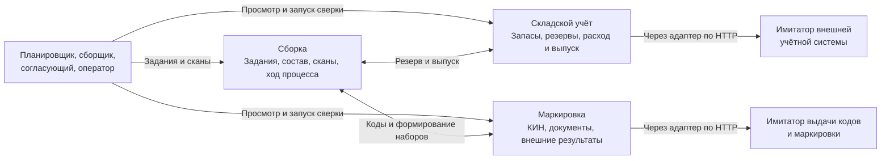

# 1 Карта контекстов

На складе из двух маркированных компонентов собирают один набор. Система должна запомнить его фактический состав, не дать использовать один код дважды и один раз провести расход и выпуск. Заказ считается готовым, когда склад подтвердил сборку, система маркировки приняла состав, а учётная система подтвердила операцию.

## Границы первой реализации

В учебную версию входят один склад `warehouse-demo`, одна неизменяемая рецептура `recipe-demo-v1`, компонент `COMP-001`, набор `SET-001` и партия от 1 до 50 наборов. Для одного набора нужны два экземпляра компонента. Начальные запасы загружаются из подготовленных учебных данных. Для стенда готовятся учебные КИН и КИ компонентов. Маркировку и внешний учёт воспроизводят два управляемых имитатора.

Приход товара, продажи, несколько складов, произвольные рецептуры, возвраты и автоматическое расформирование наборов находятся за пределами учебной версии. Первая версия охватывает процесс от резерва компонентов до выпуска готовых наборов.

## Контексты и связи

«Сборка» отправляет команды складскому учёту и маркировке. Оба сервиса возвращают результаты событиями. Все команды и события проходят через RabbitMQ. Размещение брокера и баз показано на [диаграмме контейнеров C4](02-c4-container.md).

### Сборка

«Сборка» хранит задание, снимок рецептуры, состав каждого набора, сканы и подтверждение сотрудника. Ограничения уникальности на привязки КИ компонентов и КИН защищают от использования одного кода в двух наборах. Координатор хранит текущий этап в той же базе. Склад может сохранить сканы даже при задержке учётного API. Доступные остатки определяет «Складской учёт», а внешний результат маркировки подтверждает «Маркировка».

### Складской учёт

«Складской учёт» ведёт остатки, резервы, расход и выпуск. Сервис проверяет `available = onHand − reserved` и записывает резерв в одной транзакции. Это позволяет обрабатывать одновременные запросы на резерв без превышения остатка. После подтверждения внешней учётной системы сервис один раз отражает расход и выпуск в локальном регистре и погашает резерв.

### Маркировка

«Маркировка» заказывает и хранит КИН, проверяет их принадлежность партии и сверяет документ с утверждённым составом. Сервис сохраняет намерение отправить документ и отдельно отслеживает результат внешней операции. Если ответ теряется, он сверяет исходный документ. На стенде сотрудник с ролью `signer` согласует отправку учебного документа.

## Владение данными

| Данные или правило | Единственный владелец | Что разрешено другим сервисам |
|---|---|---|
| Задание, количество, снимок рецептуры | «Сборка» | Использовать переданные идентификаторы и значения в пределах своей операции |
| Сканы, состав набора, физическое подтверждение | «Сборка» | Получить неизменяемый состав и `compositionHash` |
| Уникальная привязка КИ компонента к сборке | «Сборка» | Ссылаться на подтверждённый состав |
| Доступность компонентов и готовых наборов | «Складской учёт» | Читать данные через API и получать результаты резерва или выпуска через события |
| Резерв и журнал расхода/выпуска | «Складской учёт» | Хранить `reservationId`, `postingId` и полученный результат |
| Полученные КИН, выделение кодов и внешние документы маркировки | «Маркировка» | Использовать выделенные коды, хранить результат подтверждения и ссылку на документ |
| История отражения производственной операции в учётной системе | «Складской учёт» | Получить `ProductionRecorded` либо статус незавершённого отражения |
| Локальные журналы обработанных и исходящих сообщений и HTTP-идемпотентность | Каждый сервис для себя | Не обращаться к техническим таблицам соседнего сервиса |

Единый `orderId` связывает данные о заказе во всех сервисах. Получатель хранит снимок состава и ссылки на документы, нужные для его операции. Исходный объект изменяет только сервис-владелец.

## Отношения между контекстами

| Пара контекстов | Отношение и граница |
|---|---|
| «Сборка» → «Складской учёт» | «Сборка» запрашивает резерв и отражение выпуска. «Складской учёт» принимает решения о запасе и публикует результат |
| «Сборка» → «Маркировка» | «Сборка» запрашивает выдачу кодов и подтверждение маркировки. «Маркировка» отвечает через согласованные сообщения и самостоятельно интерпретирует внешние результаты |
| «Складской учёт» → имитатор учётной системы | Адаптер внешней системы в сервисе «Складской учёт» переводит операцию производства в контракт внешней учётной системы и обратно. Внутренние состояния резерва не подменяются статусами HTTP |
| «Маркировка» → имитатор маркировки | Адаптер внешней системы в сервисе «Маркировка» отделяет внутренние состояния кодов и формирования от протокола внешней системы. Замена симулятора не меняет контракты остальных сервисов |

«Сборка» отправляет команду сервису, который выполняет операцию, и получает событие с результатом. Формат сообщений и версии указаны в контрактах.

## Инварианты

1. Один нормализованный КИ компонента используется не более чем в одной активной или завершённой сборке; повторный скан не увеличивает количество.
2. Один выделенный КИН относится к одной единице набора. Повторная выдача ответа не создаёт новый заказ кодов.
3. Нельзя зарезервировать больше доступного количества. В учебной версии резерв не освобождается автоматически по сроку ожидания.
4. Подтверждение физической сборки возможно только при наличии всех `N` наборов с двумя компонентами в каждом. Печать этикетки не подтверждает сборку.
5. После согласования состав неизменяем. «Маркировка» сверяет полученный `compositionHash`. Изменение состава требует отдельной процедуры.
6. На одно задание приходится одна логическая операция расхода/выпуска. Повтор сообщения с тем же или новым `messageId` не создаёт второй бизнес-эффект.
7. `COMPLETED` требует физического подтверждения, подтверждённой маркировки того же состава и подтверждённого учёта. `202`, получение сообщения брокером и успешный HTTP-вызов не заменяют эти факты.
8. После неопределённого внешнего результата коды и резерв сохраняются до сверки. После подтверждённой маркировки учёт доводится до конца; автоматического освобождения компонентов или отмены внешней маркировки нет.

## Почему выбраны микросервисы

Каждый сервис меняет данные в своей базе и передаёт результат через брокер. Например, при сбое «Маркировки» принятые «Сборкой» сканы остаются в её базе, а задание ждёт ответа. За эту независимость приходится платить промежуточными состояниями и проверками при повторной доставке. Сравнение с другими вариантами приведено в [ADR](05-decisions.md).
