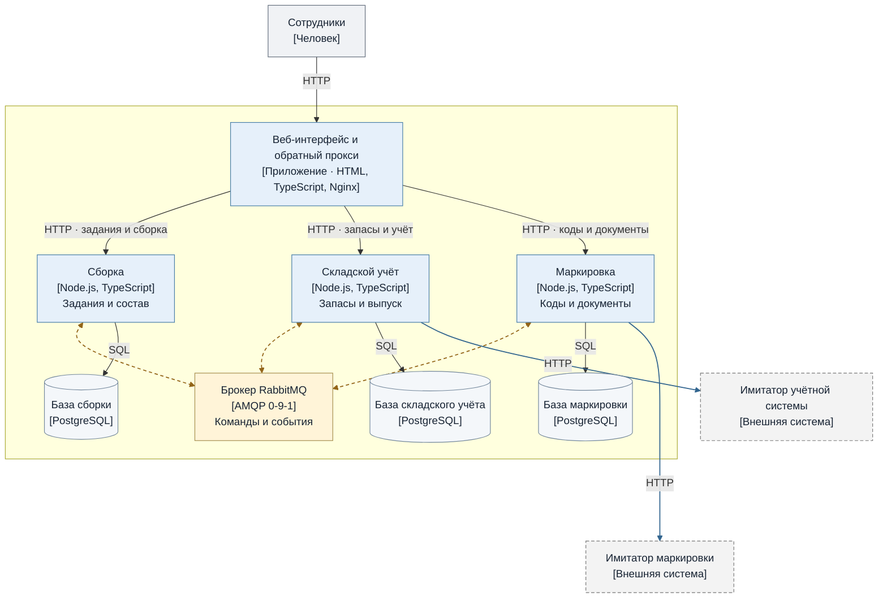

# 2 Диаграмма контейнеров C4

Диаграмма раскрывает одну программную систему — управление сборкой и выпуском маркированных наборов. Показаны приложения, их хранилища, транспорт и внешние системы. На уровне контейнеров C4 контейнером называют приложение или хранилище. Это архитектурный уровень описания, отдельный от физического развёртывания.

## Система управления маркированными наборами

Внутри рамки находятся приложения, базы и брокер проекта. Пользователи и два имитатора внешних систем показаны за рамкой.

Пунктиром показан обмен сообщениями через RabbitMQ, синими стрелками — HTTP-вызовы имитаторов. Сервисы меняют состояние по локальным запросам и сообщениям RabbitMQ. У каждого сервиса доступ только к своей базе. Издатели, получатели и ключи маршрутизации перечислены в [AsyncAPI](03-contracts.md).

## Реестр контейнеров

| Контейнер | Ответственность и хранимое состояние | Существенная граница |
|---|---|---|
| Веб-интерфейс и обратный прокси | Статические экраны, HTTP-маршрутизация. В браузере допускается незавершённый ввод, но подтверждённые сканы сохраняются сервером | Не координирует процесс и не считается владельцем бизнес-состояния |
| «Сборка» | REST API, обработчики сообщений, координатор с сохранением состояния, фоновая отправка сообщений и локальные проверки | Координатор продолжает работу при сбое браузера |
| «Складской учёт» | REST API, обработчики сообщений, контроль запаса, журнал движений, адаптер внешней учётной системы и фоновая сверка | Определяет доступность материалов и возможность резервирования |
| «Маркировка» | REST API, обработчики сообщений, управление КИН, документы, записи о планируемых внешних операциях и сверка | Отделяет внутреннюю модель от протокола внешней маркировки |
| `assembly_db` | Задания, состав, привязки КИ и КИН, физические подтверждения, ревизии и состояние саги | Доступ к базе есть только у сервиса «Сборка» |
| `inventory_db` | Запасы по артикулам, резервы, движения, записи о планируемых операциях и результаты внешнего учёта | Только «Складской учёт» изменяет доступность материалов и наборов |
| `marking_db` | Выделение кодов, операции формирования, исходный состав, попытки и подтверждения | Только «Маркировка» устанавливает факт внешнего подтверждения |
| RabbitMQ | Сохраняемые сообщения и очереди получателей, повторных попыток и разбора ошибок | Передаёт сообщения. Данные о заданиях и запасах хранятся в базах сервисов |

HTTP-сервер, обработчик входящих сообщений, фоновый отправитель сообщений и обработчик сверки являются частями соответствующего сервисного приложения. При реализации эти части одного сервиса можно запускать отдельными процессами.

## Сетевые связи и маршруты

| Откуда → куда | Протокол | Назначение |
|---|---|---|
| Браузер → Веб-интерфейс | HTTP локально, HTTPS при публикации стенда | Загрузка интерфейса и обращение к API через обратный прокси |
| Веб-интерфейс → «Сборка» | HTTP JSON, `/api/assembly` | Заказ, состояние, скан единицы, физическое подтверждение, согласование состава |
| Веб-интерфейс → «Складской учёт» | HTTP JSON, `/api/inventory` | Запас, резерв, состояние учётной операции и запуск сверки |
| Веб-интерфейс → «Маркировка» | HTTP JSON, `/api/marking` | Выделенные коды, результат формирования и запуск сверки |
| Каждый сервис → своя БД | Протокол PostgreSQL | Локальные транзакции и собственные данные |
| Каждый сервис ↔ RabbitMQ | AMQP 0-9-1 | Команды и события основного процесса |
| «Маркировка» → имитатор маркировки | HTTP JSON | `POST /operations`, `GET /operations/{operationId}` |
| «Складской учёт» → имитатор учётной системы | HTTP JSON | `POST /operations`, `GET /operations/{operationId}` |

Внешний путь создания задания через прокси — `/api/assembly/orders`. Схемы запросов и маршруты имитаторов описаны в OpenAPI.

## Транспорт сообщений

В RabbitMQ настроены тематический обменник `sets.v1` и отдельная очередь для каждого приложения. Подписки привязаны к конкретным ключам маршрутизации из каталога.

| Очередь | Получатель | Принимаемые типы |
|---|---|---|
| `assembly.v1` | «Сборка» | `ComponentsReserved`, `ComponentsReservationRejected`, `ComponentsReleased`, `SetCodesAllocated`, `SetCodeAllocationRejected`, `SetsFormationConfirmed`, `SetsFormationRejected`, `MarkingOperationUncertain`, `ProductionRecorded`, `ProductionUncertain`, `ProductionBlocked` |
| `inventory.v1` | «Складской учёт» | `ReserveComponents`, `ReleaseComponents`, `CommitProduction` |
| `marking.v1` | «Маркировка» | `AllocateSetCodes`, `FormSets` |

Ключ маршрутизации имеет вид `sets.<Type>.v1`. Каждый сервис получает предназначенные ему сообщения через свою очередь. Очереди повторных попыток и разбора ошибок (`DLQ`) тоже выделены отдельно для каждого получателя. После выяснения причины сообщение из очереди разбора можно обработать повторно с прежними идентификаторами и обычными проверками.

Отправитель сохраняет сообщения в журнале исходящих вместе с изменением доменных данных и публикует сообщения с сохранением на диске, требует возврата при отсутствии маршрута (`mandatory`) и ждёт подтверждения от брокера. Получатель одной транзакцией фиксирует обработку сообщения, изменение данных и новые исходящие сообщения, затем отправляет подтверждение обработки вручную. При повторной доставке ограничения в базе и журнал обработанных сообщений защищают от повторного эффекта. Политика повторов раскрыта в [решениях](05-decisions.md).

## Доступ и конфигурация

| Роль | Возможности в учебной версии |
|---|---|
| `planner` | Создать задание и просмотреть ход выполнения |
| `warehouse` | Просмотреть выданные синтетические коды, передать сканы и подтвердить физическую сборку |
| `signer` | Проверить состав и согласовать учебное формирование |
| `operator` | Просмотреть техническое состояние и запустить сверку внешней операции |

Локальная тестовая утилита выдаёт токены фиксированных учебных пользователей. Каждый сервис проверяет JWT и разрешённую роль. Идентификатор сотрудника извлекается из проверенного токена. В сообщении сохраняется идентификатор сотрудника без самого токена.

Бизнес-сервисы используют разные учётные записи PostgreSQL и RabbitMQ. Разрешения брокера ограничивают публикацию и подписки своего приложения. Секреты находятся в локальной конфигурации окружения, в репозиторий не входят. Полные рабочие коды маркировки, сертификаты и токены внешних систем для стенда не нужны.

## Отказы и размещение учебного стенда

На одном компьютере можно разместить три базы в одном экземпляре PostgreSQL и выдать сервисам отдельные учётные записи. Если этот экземпляр остановится, все три сервиса потеряют доступ к своим данным. Для демонстрации независимого отказа останавливаем одно приложение.

| Отказавшая часть | Наблюдаемое поведение |
|---|---|
| «Сборка» или assembly_db | Новые сканы не подтверждаются. Уже зафиксированные данные остаются в базе. После восстановления обработчик продолжает с сохранённого этапа |
| «Складской учёт» или inventory_db | Задания ждут резерва либо учётного завершения. Другие сервисы не принимают решение об освобождении запаса вместо владельца |
| «Маркировка» или marking_db | Процесс ждёт кодов либо результата формирования. Существующие данные сборки сохраняются |
| RabbitMQ | Новые межсервисные переходы задерживаются в журнале исходящих сообщений. Локально принятые операции остаются в базе, а интерфейс показывает состояние ожидания |
| имитатор маркировки | «Маркировка» сохраняет внешнее намерение и сверяет его по исходному `operationId`. Неопределённый результат не вызывает повторную выдачу кодов или освобождение резерва |
| имитатор учётной системы | «Складской учёт» удерживает резерв и незавершённую операцию. После восстановления сверяет исходный `postingId` и один раз записывает движения в локальный регистр |
| Веб-интерфейс или браузер | Сотрудник временно теряет доступ к интерфейсу. Координатор, обработка сообщений и сверка продолжаются на сервере |

Пока внешняя система недоступна, заказ остаётся в ожидании. Противоречивые результаты требуют разбора оператором. Три последовательности отказов приведены в [главном процессе](04-main-process.md).

## Основания нотации

- [Модель C4, диаграмма контейнеров](https://c4model.com/diagrams/container): выбранный уровень архитектуры.
- [Синтаксис блок-схем Mermaid](https://mermaid.js.org/syntax/flowchart.html)
