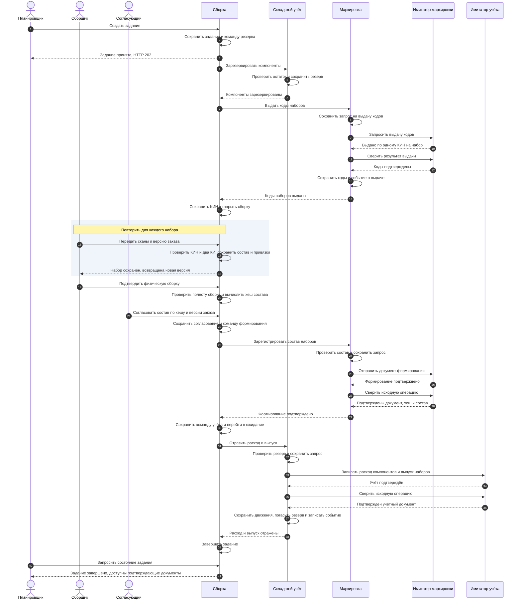
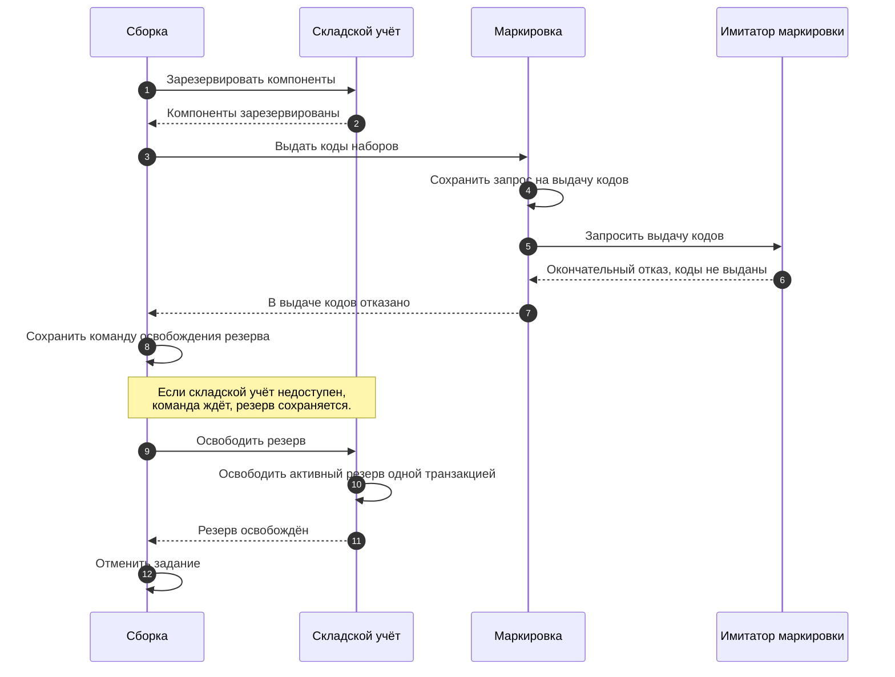
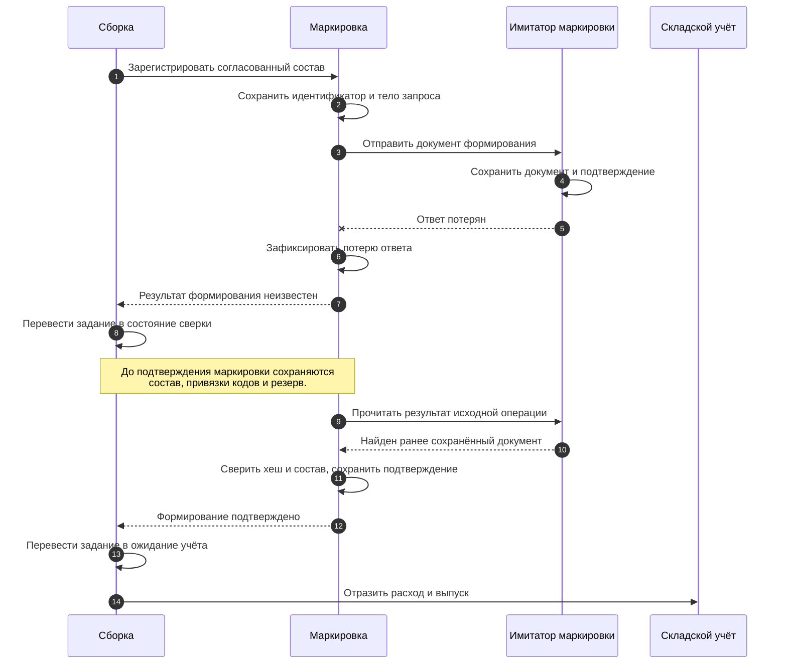
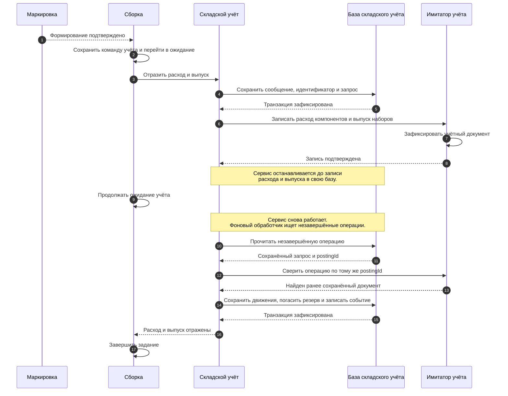
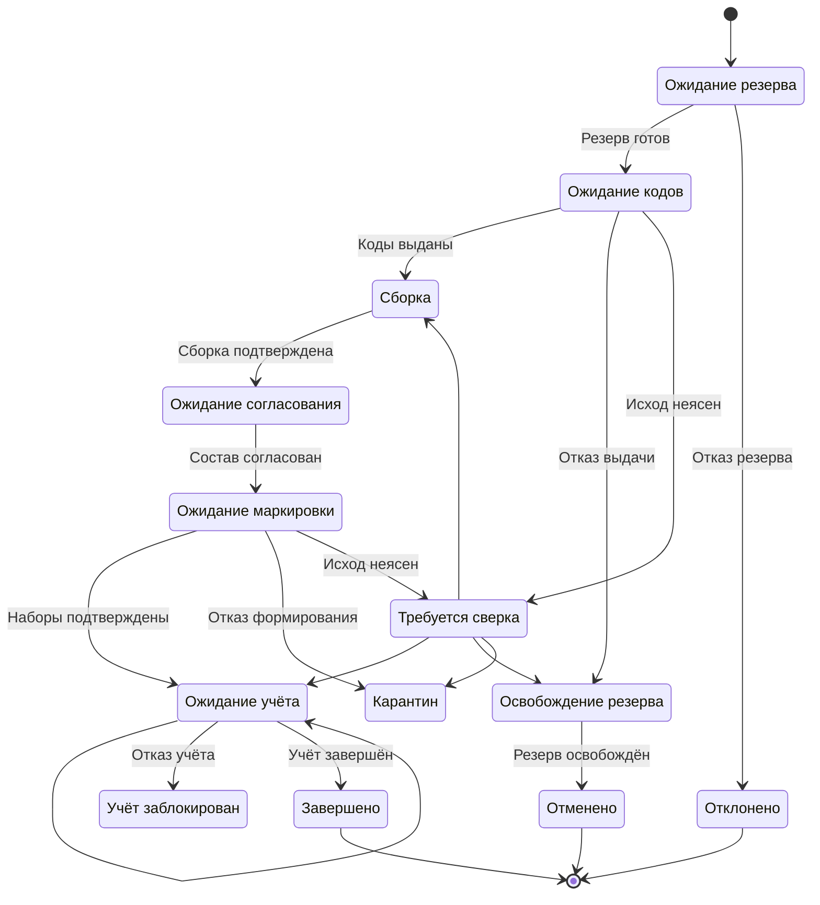

# 4 Главный процесс и восстановление

## Результат и исходные условия

Заказ на `N` наборов требует `2N` единиц `COMP-001`. Можно заказать от 1 до 50 наборов. После сборки и подтверждения маркировки «Складской учёт» проводит расход компонентов и приход наборов `SET-001`. Результаты маркировки и учёта должны относиться к тому же заказу и составу.

До запуска доступны неизменяемая рецептура `recipe-demo-v1`, начальные остатки одного склада и синтетические коды компонентов. После восстановления хранилищ и внешних систем фоновые обработчики продолжают работу с сохранённого этапа, даже если браузер закрыт.

«Сборка» хранит задание, сканы и состояние саги. «Складской учёт» ведёт остатки, резерв и учётную операцию. «Маркировка» хранит сведения о выдаче кодов, документе и результате маркировки. «Сборка» координирует работу через сообщения брокера. [Контракты HTTP](03-contracts.md), [контракты сообщений](contracts/asyncapi-assembly.yaml).

Стрелки между тремя сервисами обозначают команды и события, доставляемые через RabbitMQ. Стрелки от сотрудников и к внешним имитаторам показывают HTTP-вызовы. Записи в журналах показаны в тех местах, где они объясняют восстановление после сбоя.

## Успешное выполнение

Ответ `202` означает, что сервис принял команду и сохранил её для обработки. Если ответ потерялся, клиент повторяет запрос с исходным ключом идемпотентности. При неизвестном результате внешней записи сервис сначала сверяет исходную операцию.

Сканы фиксируются в сервисе «Сборка» одной транзакцией вместе с привязками кодов. Повтор скана или сообщения не увеличивает количество. Версия заказа изменяется при принятом изменении, а устаревший `If-Match` даёт `412`. Если это повтор уже принятого запроса с тем же ключом и телом, возвращается первоначальный ответ до проверки версии. После физического подтверждения состав фиксируется. Сотрудник с ролью `signer` согласует его по конкретному `compositionHash`.

## Отказ 1. Выдача кодов окончательно отклонена

Компоненты зарезервированы. Имитатор маркировки окончательно отклонил выдачу и подтвердил, что коды не выпущены. Сканирование ещё недоступно.

Компенсация освобождает количественный резерв. Уменьшается зарезервированный объём `reserved`, а фактическое наличие `onHand` сохраняется, потому что расхода ещё не было. «Сборка» отменяет заказ после подтверждения `ComponentsReleased`. Пока «Складской учёт» недоступен, команда ждёт в журнале исходящих сообщений или очереди, а заказ остаётся в состоянии `COMPENSATING`.

При недостатке материалов «Складской учёт» сразу отклоняет резерв и публикует `ComponentsReservationRejected`. Заказ переходит в `REJECTED`. Освобождать материалы в этом случае не требуется.

## Отказ 2. Документ принят маркировкой, но ответ потерян

Сотрудники подтвердили упаковку и состав. Имитатор сохранил документ формирования, но соединение оборвалось до получения ответа. «Маркировка» фиксирует неопределённый результат и сверяет исходную операцию.

«Маркировка» читает результат по исходному `formationId` и сверяет хеш, тип операции и состав. Пока результат неизвестен, «Складской учёт» сохраняет резерв, а «Сборка» сохраняет привязки кодов. После подтверждения маркировки начинается учёт выпуска.

Первый запрос может ещё выполняться, когда GET возвращает `NOT_FOUND`. В учебном имитаторе повтор безопасен благодаря атомарной идемпотентности. Фоновый обработчик повторяет исходный POST с теми же `operationId`, видом операции, `payloadHash` и байтами тела. Если запись уже есть, имитатор вернёт её без второго эффекта. То же правило позволяет восстановиться, если сервис остановился до первой отправки. При `PROCESSING` или `UNKNOWN` обработчик откладывает следующую сверку. По запросу оператора сверка также начинается с чтения исходной операции.

Если найден окончательный отказ **формирования** после физической сборки, `SetsFormationRejected` переводит заказ в `QUARANTINED`. Резерв и привязки кодов сохраняются. Разбор физической продукции и возможная корректирующая процедура требуют отдельного процесса, который находится за пределами учебной версии. До разбора наборы остаются в карантине.

## Отказ 3. Маркировка подтверждена, учёт прерван посередине

Внешняя система подтвердила маркировку, затем учётная система приняла выпуск и расход. Сервис «Складской учёт» остановился до записи результата в собственной базе. При запуске он сверяет внешний итог и завершает локальную операцию.

«Складской учёт» завершает операцию по исходному `postingId`. Резерв удерживается до локального подтверждения. Только после него готовые наборы становятся доступными в складском регистре.

Если учётная система недоступна, обработчик ждёт и затем сверяет исходный `postingId`. При `NOT_FOUND` он может повторить исходный POST по гарантии идемпотентности имитатора. При `PROCESSING` или `UNKNOWN` он продолжает сверку. При неизвестном результате публикуется `ProductionUncertain`, и заказ остаётся в `ACCOUNTING_PENDING`. Если учётная система окончательно отклоняет операцию, событие `ProductionBlocked` переводит заказ в `ACCOUNTING_BLOCKED`. Для исправления нужен отдельный процесс ручного разбора. Подтверждённая маркировка сохраняется.

## Автомат состояний задания

После сверки результат определяет следующую стадию: выданные коды разрешают сборку, подтверждённое формирование запускает учёт, окончательный отказ выдачи освобождает резерв, а отказ формирования переводит наборы в карантин. Сервис проверяет сохранённую стадию `resumeStage` и идентификатор ожидаемой операции, чтобы не перепутать выдачу кодов с формированием. При неизвестном результате учёта заказ остаётся в ожидании. «Учёт заблокирован» и «Карантин» требуют ручного разбора.

## Сохранность сообщений и порядок восстановления

| Момент отказа | Сохранившиеся данные | Действие после восстановления |
|---|---|---|
| Сервис «Сборка» сохранил заказ, брокер недоступен | Заказ и журнал исходящих сообщений в одной транзакции | Отправитель публикует исходное сообщение после восстановления брокера |
| Брокер принял сообщение, отправитель не получил подтверждение публикации | Та же запись в журнале исходящих сообщений и `messageId` | Повтор публикации; журнал обработанных сообщений и бизнес-ограничения исключают повторный эффект |
| Обработчик зафиксировал транзакцию и остановился до подтверждения | Журнал обработанных сообщений, изменения данных и исходящие события | Обработчик узнаёт повтор по `messageId` и подтверждает его без повторной операции |
| Обработчик остановился до фиксации транзакции | Входящее сообщение ещё не подтверждено | Брокер доставляет его повторно, обработчик начинает транзакцию заново |
| БД одного сервиса недоступна | Брокер не получил подтверждение. У других сервисов остаются свои базы | Вход не подтверждается, доменная операция ждёт восстановления своего владельца |
| Сотрудник закрыл браузер | Уже принятые сканы и состояние саги в базе сервиса «Сборка» | Рабочее место перечитывает состояние; фоновые операции продолжаются без браузера |

Журналы позволяют восстановиться, если сервис успел записать изменения в свою базу, но потерял связь с брокером. Для операций в учётной системе или маркировке сервис отдельно сохраняет запрос и сверяет его результат во внешней системе.

Потребитель записывает намерение выполнить операцию и подтверждает сообщение брокеру. Фоновый обработчик делает внешний вызов отдельно. После перезапуска он подбирает незавершённые операции. На стенде достаточно одного обработчика на сервис. Если их несколько, временная блокировка защищает от одновременного выполнения одного `operationId`. Истечение временной блокировки разрешает сверку. Повтор исходного POST допускается только после `NOT_FOUND` и по гарантии идемпотентности симулятора.

«Складской учёт» принимает `ReleaseComponents` только для резерва `ACTIVE`, если запрос на проведение выпуска ещё не сохранён. Поздняя команда не освободит компоненты, расход которых внешняя система могла уже провести.

## Идентификаторы и защита от перестановки событий

- `orderId` — сквозной идентификатор процесса. `reservationId`, `allocationId`, `formationId`, `postingId` создаются один раз и сохраняются до публикации команды.
- `messageId` идентифицирует сообщение. Отправитель при повторной публикации сохраняет его. Если та же операция придёт с новым `messageId`, повтор остановят её бизнес-ключи.
- Уникальность кодов проверяется в сервисе «Сборка»; уникальность резерва и учётных движений — в сервисе «Складской учёт»; уникальность внешней попытки и выдачи КИН — в сервисе «Маркировка».
- `aggregateVersion` относится к агрегату отправителя. Версии разных сервисов не сравниваются. Потребитель применяет событие по ожидаемой стадии и ID операции, сверяя её данные.
- Поздний `MarkingOperationUncertain` не откатывает уже подтверждённое формирование. Поздний повтор `ComponentsReserved` не создаёт новую выдачу кодов. Противоречащие окончательные результаты одной операции блокируют дальнейшие изменения и требуют сверки.
- Нет глобальной гарантии порядка RabbitMQ для всех сообщений. Допустимый результат, пришедший раньше своего этапа, сохраняется для повторной проверки. Противоречивые результаты разбирает оператор. Сообщение, нарушающее схему, не меняет данные заказа.
- После ограниченного числа технических повторов сообщение попадает в очередь разбора ошибок (`DLQ`), а оператор получает уведомление. При повторной обработке сохраняются `messageId` и исходные идентификаторы операций. Ресурсы остаются зарезервированными при попадании сообщения в эту очередь и при истечении времени ожидания.

## Основания решений

Правила компенсации, доставки и внешней сверки приведены в [ADR 0002](adr/0002-orchestrated-saga.md), [ADR 0003](adr/0003-outbox-inbox.md) и [ADR 0004](adr/0004-external-outcomes.md).

Ссылки на документацию: [шаблон «сага»](https://learn.microsoft.com/en-us/azure/architecture/patterns/saga), [подтверждения RabbitMQ](https://www.rabbitmq.com/docs/confirms).
